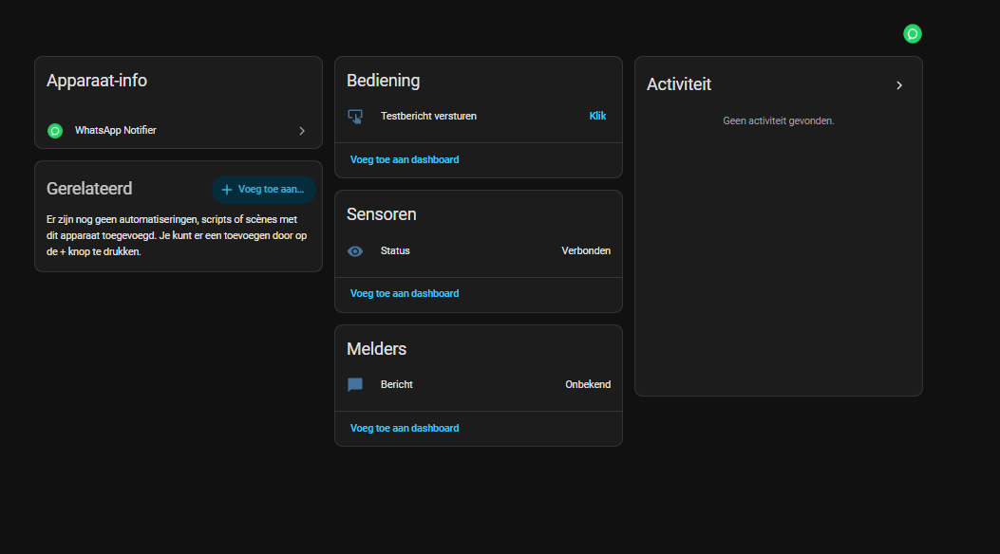

# WhatsApp Notifier for Home Assistant

Send WhatsApp messages from Home Assistant to a person or a group, and react to replies, **without a third-party service** (no Green-API). Everything runs on your own Home Assistant.

It has two parts:

1. **Bridge add-on** (`whatsapp_bridge/`): a small Node service using [Baileys](https://github.com/WhiskeySockets/Baileys). It links to your WhatsApp account as a *linked device* (like WhatsApp Web).
2. **Integration** (`custom_components/whatsapp_notifier/`): a notify entity, a `send_message` service, a status sensor, a test button and an event for incoming messages.



> **Disclaimer:** Baileys uses the unofficial WhatsApp Web protocol. This is against WhatsApp's terms and the account can be banned. Use a dedicated number, send low volumes, never spam.

## Install

### 1. Bridge add-on

1. HA > Settings > Add-ons > Add-on store > ⋮ > Repositories: add `https://github.com/Anonymouse0104/ha-whatsapp-notifier`. Install **WhatsApp Bridge**.
2. On the *Configuration* tab set:
   - `api_token` (**required**): make up a long password. The bridge refuses to start without one. You need it again below.
   - `pairing_phone`: leave **empty** to link with a QR code (recommended, see below).
3. Save and start the add-on.

### 2. Link your WhatsApp (QR code)

1. Open `http://homeassistant.local:8099/qr?token=<api_token>` on a computer. You see a QR code that refreshes every 15 seconds.
2. On the phone of the number that will send the messages: WhatsApp > Settings > Linked devices > Link a device, and scan the QR code.
3. The add-on log now shows `status connected` (a `515` stream error right after linking is normal). The session is stored in the add-on's `/data`, so restarts need no new pairing.

Alternative: put your number in `pairing_phone` (international, digits only, e.g. `31612345678`), restart the add-on and enter the 8-character code from the log under *Link with phone number instead*. This has failed on some iPhones, so prefer the QR code. Never use both at once: clear `pairing_phone` when you use the QR page.

### 3. Integration

1. Install via HACS: ⋮ > Custom repositories > this repo's URL, category *Integration*. Restart HA. (Or copy `custom_components/whatsapp_notifier` into your config folder.)
2. Settings > Devices > Add integration > **WhatsApp Notifier**: host `homeassistant.local` (or the HA address), port `8099`, your `api_token` and the **default chat ID** ([how to find it](#finding-chat-ids)). Change the default later with the integration's *Configure* button.

You get one device with:

| Entity | What it does |
|---|---|
| Message (`notify`) | Sends to the default chat. Shows *unknown* until the first message is sent; that is normal. |
| Status (`sensor`) | `connected`, `connecting`, `pairing_required`, `logged_out`, `error` or `bridge_unreachable`. |
| Send test message (`button`) | Sends a test message to the default chat. |

Entity IDs follow your HA language (check them under Developer tools > States).

No add-ons (HA Container/Core)? Run the bridge anywhere: `cd whatsapp_bridge && npm ci && API_TOKEN=secret node index.js`, then open `/qr` as above. Optional env vars: `PORT`, `PAIRING_PHONE`, `AUTH_DIR`.

## Finding chat IDs

**A person:** the phone number with country code, digits only, no `+`, no leading `0`.
`06 12345678` in the Netherlands becomes `31612345678`. (`31612345678@c.us` and `31612345678@s.whatsapp.net` also work, so Green-API automations keep working.)

**A group:** open this in a browser on your network:

```
http://homeassistant.local:8099/groups?token=<api_token>
```

You get a list like `[{"chat_id":"120363012345678901@g.us","name":"Family"}, ...]`. Copy the whole `chat_id`, including `@g.us`. The linked number must be a member of the group. If the group is missing, wait a minute and reload.

## Sending

Default chat (from the integration options):

```yaml
action: notify.send_message
target:
  entity_id: notify.whatsapp_message
data:
  message: "The bins go out tomorrow"
```

Another chat (overrides the default). It also returns the id of the sent message:

```yaml
action: whatsapp_notifier.send_message
data:
  chat_id: "120363012345678901@g.us"
  message: "Dinner is ready"
```

Omit `chat_id` and the default chat is used. Use `response_variable` to get `message_id`.

## Testing

1. `Status` shows *Connected*.
2. Press **Send test message**. A message should arrive in the default chat.
3. Try `whatsapp_notifier.send_message` in Developer tools > Actions with another `chat_id`.
4. If something fails, check the add-on log and the *Status* sensor (`pairing_required` or `logged_out` means: link again via `/qr`).

## Replies

Incoming messages are only passed on from chats you list (privacy: everything else is dropped in the bridge). Add them in HA: Settings > Devices > WhatsApp Notifier > *Configure* > **Chats to receive messages from** (one chat ID per entry, e.g. `120363012345678901@g.us`). Changes apply right away.

Each incoming text message then fires the event `whatsapp_notifier_message_received` with `chat_id`, `sender`, `text`, `from_me`, `is_group`, `id` and `quoted_message_id` (the id of the message that was replied to). There is no built-in rule engine: use normal automations, so any language works. Example: ask, then wait up to 10 minutes for "yes" as a reply *to that message*:

```yaml
actions:
  - action: whatsapp_notifier.send_message
    data: { message: "Bins out tomorrow. Already outside?" }
    response_variable: sent
  # keep waiting until someone answers our message; other chat messages are skipped.
  # On timeout the script stops.
  - repeat:
      sequence:
        - wait_for_trigger:
            - trigger: event
              event_type: whatsapp_notifier_message_received
          timeout: "00:10:00"
          continue_on_timeout: false
      # answer words in any language you like
      until: >
        {{ wait.trigger.event.data.quoted_message_id == sent.message_id
           and wait.trigger.event.data.text | lower | trim in ['yes', 'ja', 'oui'] }}
  - action: input_boolean.turn_on
    target: { entity_id: input_boolean.bins_outside }
```

To accept any reply in the chat (not only to that message) drop the `quoted_message_id` test.

## Same number for sending and replying

Messages you type on your own phone arrive on the linked device too (`from_me: true`); the bridge only drops its *own* sends, so your replies should reach HA. **This is untested** and in groups WhatsApp may report senders as `@lid` ids. If it misbehaves, use a separate number for the bridge (recommended).

## Security

- Only one bridge per Home Assistant is supported; `whatsapp_notifier.send_message` uses the first configured one.
- Anyone with the `api_token` can send messages as your account. Keep port 8099 inside your network and never forward it to the internet.

## Status

Linking and the status sensor are confirmed to work. Sending (test button, groups), replies and the same-number case still need real-world feedback: please open an issue.
