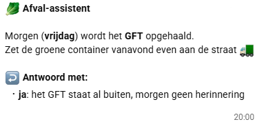
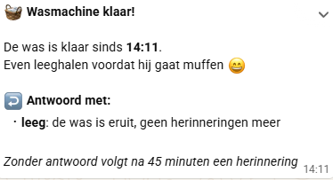
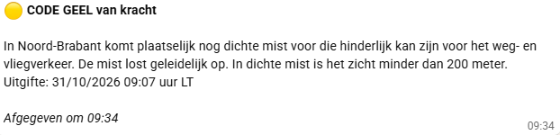

<div align="center">


# WhatsApp Notifier

[](https://my.home-assistant.io/redirect/hacs_repository/?owner=Anonymouse0104&repository=ha-whatsapp-notifier&category=integration) [](https://ko-fi.com/anonymouse0501)

[Nederlands](#nederlands) | [English](#english)

</div>

## Nederlands

Stuur WhatsApp-berichten vanuit Home Assistant naar een persoon of groep, en reageer op antwoorden, **zonder externe dienst** (geen Green-API). Alles draait op je eigen Home Assistant.

Het bestaat uit twee delen:

1. **Bridge-app** (`whatsapp_bridge/`, vóór Home Assistant 2026.2 een add-on genoemd): een kleine Node-service met [Baileys](https://github.com/WhiskeySockets/Baileys). Hij koppelt aan je WhatsApp-account als *gekoppeld apparaat* (zoals WhatsApp Web).
2. **Integratie** (`custom_components/whatsapp_notifier/`): een statussensor, een testknop, een `send_message`-service en **één apparaat per chat** met een eigen notify-entiteit en een sensor "Laatste bericht".

Vereist Home Assistant 2025.3 of nieuwer.

> **Disclaimer:** Baileys gebruikt het onofficiële WhatsApp Web-protocol. Dat is in strijd met de voorwaarden van WhatsApp en het account kan geblokkeerd worden. Gebruik een apart nummer, verstuur weinig berichten en spam nooit.

### Voorbeelden

Berichten die met deze integratie vanuit Home Assistant zijn verstuurd:

<p>
  
  
  
</p>

De eerste twee vragen om een antwoord. Een antwoord op het bericht kan de herinnering stoppen, zie [Antwoorden](#antwoorden).

### Installatie

#### 1. Bridge-app

1. Klik op deze knop om de repository aan je Home Assistant toe te voegen en installeer daarna **WhatsApp Bridge**:

   [](https://my.home-assistant.io/redirect/supervisor_add_addon_repository/?repository_url=https%3A%2F%2Fgithub.com%2FAnonymouse0104%2Fha-whatsapp-notifier)

   Of voeg hem handmatig toe: HA > Instellingen > Apps, open de store, dan ⋮ > Repositories, en voeg `https://github.com/Anonymouse0104/ha-whatsapp-notifier` toe. (Vóór Home Assistant 2026.2 heette dit Instellingen > Add-ons.)
2. Stel op het tabblad *Configuratie* in:
   - `api_token` (**verplicht**): verzin een lang wachtwoord. De bridge start niet zonder. Je hebt het hieronder opnieuw nodig.
   - `pairing_phone`: laat **leeg** om met een QR-code te koppelen (aanbevolen, zie hieronder).
3. Sla op en start de app.

#### 2. WhatsApp koppelen (QR-code)

1. Open op een computer `http://homeassistant.local:8099/qr?token=<api_token>`. Je ziet een QR-code die elke 15 seconden ververst.
2. Op de telefoon van het nummer dat de berichten gaat versturen: WhatsApp > Instellingen > Gekoppelde apparaten > Apparaat koppelen, en scan de QR-code.
3. In het log van de app staat nu `status connected` (een `515` stream-fout direct na het koppelen is normaal). De sessie wordt bewaard in `/data` van de app, dus na een herstart hoef je niet opnieuw te koppelen.

Alternatief: vul je nummer in bij `pairing_phone` (internationaal, alleen cijfers, bijvoorbeeld `31612345678`), herstart de app en voer de code van 8 tekens uit het log in onder *Koppelen met telefoonnummer*. Dit werkte op sommige iPhones niet, dus geef de voorkeur aan de QR-code. Gebruik nooit beide tegelijk: maak `pairing_phone` leeg als je de QR-pagina gebruikt.

#### 3. Integratie

1. Installeer via HACS: ⋮ > Aangepaste repositories > de URL van deze repo, categorie *Integratie*. Herstart HA. (Of kopieer `custom_components/whatsapp_notifier` naar je config-map.)
2. Instellingen > Apparaten en services > Integratie toevoegen > **WhatsApp Notifier**: host `homeassistant.local` (of het HA-adres), poort `8099`, je `api_token` en eventueel een **standaard chat-ID**. Wijzig de standaard later met de knop *Configureren* van de integratie.

Geen apps (HA Container/Core)? Draai de bridge ergens anders: `cd whatsapp_bridge && npm ci && API_TOKEN=secret node index.js` en open daarna `/qr` zoals hierboven. Optionele omgevingsvariabelen: `PORT`, `PAIRING_PHONE`, `AUTH_DIR`.

### Chat-ID's vinden

**Een persoon:** het telefoonnummer met landcode, alleen cijfers, zonder `+` en zonder voorloop-`0`.
`06 12345678` in Nederland wordt `31612345678`. (`31612345678@c.us` en `31612345678@s.whatsapp.net` werken ook, zodat Green-API-automatiseringen blijven werken.)

**Een groep:** open dit in een browser op je netwerk:

```
http://homeassistant.local:8099/groups?token=<api_token>
```

Je krijgt een lijst als `[{"chat_id":"120363012345678901@g.us","name":"Familie"}, ...]`. Kopieer de hele `chat_id`, inclusief `@g.us`. Het gekoppelde nummer moet lid van de groep zijn. Ontbreekt de groep, wacht dan een minuut en laad opnieuw.

### Chats: één apparaat per chat

Druk op de integratiepagina (Instellingen > Apparaten en services > WhatsApp Notifier) op **Chat toevoegen** en vul in:

- **Naam**: wordt de apparaatnaam, bijvoorbeeld "Familiegroep".
- **Chat-ID**: een nummer of groeps-ID, zie hierboven.
- **Alleen antwoorden op berichten van deze bridge**: zie [Antwoorden](#antwoorden).

Elke chat wordt een eigen apparaat met:

| Entiteit | Wat het doet |
|---|---|
| Bericht (`notify`) | Verstuurt naar deze chat. |
| Testbericht versturen (`button`) | Verstuurt een testbericht naar deze chat. |
| Laatste bericht (`sensor`) | De state is de tekst van het laatst ontvangen bericht in deze chat (max. 255 tekens). Attributen: `text`, `sender`, `chat_id`, `from_me`, `is_group`, `id`, `quoted_message_id`, `quoted_text`, `quoted_from_me`. |

Gebruik *⋮ > Opnieuw configureren* bij de chat om hem te wijzigen, of verwijder hem om het apparaat te verwijderen. **Inkomende berichten worden alleen doorgegeven van chats die je hebt toegevoegd** (privacy: al het andere wordt in de bridge weggegooid).

Het hoofdapparaat **WhatsApp** (de bridge) heeft:

| Entiteit | Wat het doet |
|---|---|
| Status (`sensor`) | `connected`, `connecting`, `pairing_required`, `logged_out`, `error` of `bridge_unreachable`. |
| Testbericht versturen (`button`) | Verstuurt een testbericht naar de standaard chat. |
| Bericht (`notify`) | Verstuurt naar de **standaard chat** uit de opties van de integratie. Toont *onbekend* tot het eerste bericht; dat is normaal. |

Entity-ID's volgen de taal van je HA (controleer ze onder Ontwikkelaarstools > Statussen).

### Versturen

Naar een chat die je hebt toegevoegd, met zijn notify-entiteit:

```yaml
action: notify.send_message
target:
  entity_id: notify.familiegroep_bericht
data:
  title: "Containers"
  message: "Morgen gaan de containers buiten"
```

Naar elke chat (of de standaard chat als `chat_id` wegblijft); dit geeft ook het id van het verstuurde bericht terug:

```yaml
action: whatsapp_notifier.send_message
data:
  chat_id: "120363012345678901@g.us"
  message: "Het eten is klaar"
response_variable: sent   # sent.message_id
```

WhatsApp-opmaak werkt in de tekst: `*vet*`, `_cursief_`, `~doorgehaald~`.

### Testen

1. `Status` toont *Connected*.
2. Druk op **Testbericht versturen** bij een chat-apparaat (gaat naar die chat) of bij het hoofdapparaat WhatsApp (gaat naar de standaard chat uit *Configureren*).
3. Roep `whatsapp_notifier.send_message` aan in Ontwikkelaarstools > Acties met een `chat_id`.
4. Gaat er iets mis, bekijk dan het log van de app en de sensor *Status* (`pairing_required` of `logged_out` betekent: opnieuw koppelen via `/qr`).

### Antwoorden

Schrijft iemand in een chat die je hebt toegevoegd, dan wordt de sensor **Laatste bericht** van die chat bijgewerkt en komt het event `whatsapp_notifier_message_received` met dezelfde velden als de sensorattributen.

**Een afbeelding versturen:** geef `whatsapp_notifier.send_message` een `image` (pad naar een PNG of JPEG, max. 5 MB). Het `message` wordt het onderschrift. Het bestand moet in een map staan die Home Assistant toestaat, zoals `/config/www` (of een map uit `allowlist_external_dirs`). Dit vereist bridge-add-on 0.3.0 of nieuwer.

```yaml
action: whatsapp_notifier.send_message
data:
  chat_id: "120363012345678901@g.us"
  message: "Weekgrafiek"
  image: /config/www/chart.png
```

**Antwoord op één specifiek bericht:** in WhatsApp kunnen mensen een bericht wegvegen en daarop antwoorden. Dan is `quoted_message_id` het id van het beantwoorde bericht, `quoted_text` de tekst ervan, en `quoted_from_me` is `true` als het een bericht van de bridge was. Vink bij een chat *Alleen antwoorden op berichten van deze bridge* aan en de sensor negeert al het andere. Om een antwoord aan één exact bericht te koppelen, vergelijk je `quoted_message_id` met de `message_id` die `whatsapp_notifier.send_message` teruggeeft.

Voorbeeld: vraag iets en wacht maximaal 10 minuten op "ja" als antwoord *op dat bericht*:

```yaml
actions:
  - action: whatsapp_notifier.send_message
    data: { message: "Morgen komen de containers. Staan ze al buiten?" }
    response_variable: sent
  # blijf wachten tot iemand ons bericht beantwoordt; andere chatberichten worden overgeslagen.
  # Bij een timeout stopt het script.
  - repeat:
      sequence:
        - wait_for_trigger:
            - trigger: event
              event_type: whatsapp_notifier_message_received
          timeout: "00:10:00"
          continue_on_timeout: false
      # antwoordwoorden in elke taal die je wilt
      until: >
        {{ wait.trigger.event.data.quoted_message_id == sent.message_id
           and wait.trigger.event.data.text | lower | trim in ['ja', 'yes', 'oui'] }}
  - action: input_boolean.turn_on
    target: { entity_id: input_boolean.containers_buiten }
```

#### Tips voor automatiseringen op de sensor

- Stuurt iemand twee keer dezelfde tekst ("ja", "ja"), dan verandert de **state** van de sensor niet, alleen het attribuut `id`. Een state-trigger met `to:` gaat dan maar één keer af. Trigger op *elke* wijziging van de sensor (zonder `to:`), of gebruik het event zoals hierboven.
- De sensor is leeg na een herstart van Home Assistant tot het volgende bericht binnenkomt.
- `sender` kan in groepen een interne WhatsApp-id (`...@lid`) zijn in plaats van een telefoonnummer.

### Kant-en-klaar script

Een script dat een opgemaakt bericht (emoji, vette kop, tekst, cursieve voetnoot) naar een chat stuurt en terugvalt op een telefoonmelding als WhatsApp faalt. Vervang `notify.mobile_app_JOUW_TELEFOON`. Laat `chat_id` leeg om de standaard chat te gebruiken.

```yaml
alias: WhatsApp melding
description: Stuur een opgemaakt WhatsApp-bericht, met een telefoonmelding als terugval.
icon: mdi:whatsapp
mode: parallel
max: 20
fields:
  emoji:
    name: Emoji
    example: "🧺"
    selector: { text: }
  kop:
    name: Kop
    description: Wordt vet weergegeven
    required: true
    example: Wasmachine klaar!
    selector: { text: }
  tekst:
    name: Tekst
    required: true
    example: De was is klaar.
    selector:
      text:
        multiline: true
  voetnoot:
    name: Voetnoot
    description: Optionele cursieve regel onderaan
    selector: { text: }
  chat_id:
    name: Chat-ID
    description: Laat leeg voor de standaard chat
    selector: { text: }
sequence:
  - variables:
      body: |-
        {{ emoji }} *{{ kop }}*

        {{ tekst }}

        _{{ voetnoot }}_
  - action: whatsapp_notifier.send_message
    data:
      chat_id: "{{ chat_id | default('') }}"
      message: "{{ body }}"
    response_variable: sent
    continue_on_error: true
  - alias: Terugval op de telefoon als WhatsApp faalt
    if:
      - condition: template
        value_template: "{{ sent is not defined or sent.message_id is not defined }}"
    then:
      - action: notify.mobile_app_JOUW_TELEFOON
        data:
          title: "{{ kop }}"
          message: "{{ tekst }} (WhatsApp mislukt)"
```

Gebruik het vanuit een automatisering met `action: script.whatsapp_melding` en `data: { kop: ..., tekst: ... }`.

### Hetzelfde nummer voor versturen en antwoorden

Berichten die je op je eigen telefoon typt komen ook aan op het gekoppelde apparaat (`from_me: true`); de bridge negeert alleen zijn *eigen* berichten, dus je antwoorden horen HA te bereiken. Antwoorden vanaf je eigen telefoon op een bridgebericht in een groep zou ook moeten werken (`quoted_from_me` is dan `true`), maar dat is nog niet bevestigd. In groepen kan WhatsApp afzenders als `@lid`-id's melden. Gaat het mis, gebruik dan een apart nummer voor de bridge (aanbevolen).

### Beveiliging

- Per Home Assistant wordt maar één bridge ondersteund; `whatsapp_notifier.send_message` gebruikt de eerste die is ingesteld.
- De bridge verstuurt maximaal 20 berichten per minuut (daarboven geeft hij een fout), om je nummer te beschermen tegen een op hol geslagen automatisering.
- Iedereen met de `api_token` kan berichten versturen als jouw account. Houd poort 8099 binnen je netwerk en zet hem nooit open naar internet.

### Status

Koppelen, versturen naar een groep en de sensor *Laatste bericht* werken aantoonbaar. Apparaten per chat en *Alleen antwoorden* hebben feedback uit de praktijk nodig: open gerust een issue.

### Werkt samen met

Andere integraties van dezelfde auteur die hun berichten via deze versturen:

- [Workout Buddy](https://github.com/Anonymouse0104/ha-workout-buddy): workout-samenvattingen en dagoverzichten met een grafiek, naar een persoon of groep.
- [Brandweerrooster](https://github.com/Anonymouse0104/ha-brandweerrooster): uitrukmeldingen en statistieken van de brandweer.
- [RWM Afvalkalender](https://github.com/Anonymouse0104/ha-rwm-afval): herinneringen voor afvalophaling (Echt-Susteren, Nederlands).

### Steun

Bespaart deze integratie je tijd, dan kun je me [steunen op Ko-fi](https://ko-fi.com/anonymouse0501). Het is helemaal optioneel en de integratie blijft in beide gevallen gratis.

---

## English

Send WhatsApp messages from Home Assistant to a person or a group, and react to replies, **without a third-party service** (no Green-API). Everything runs on your own Home Assistant.

It has two parts:

1. **Bridge app** (`whatsapp_bridge/`, called an add-on before Home Assistant 2026.2): a small Node service using [Baileys](https://github.com/WhiskeySockets/Baileys). It links to your WhatsApp account as a *linked device* (like WhatsApp Web).
2. **Integration** (`custom_components/whatsapp_notifier/`): a status sensor, a test button, a `send_message` service, and **one device per chat** with its own notify entity and "Last message" sensor.

Needs Home Assistant 2025.3 or newer.

> **Disclaimer:** Baileys uses the unofficial WhatsApp Web protocol. This is against WhatsApp's terms and the account can be banned. Use a dedicated number, send low volumes, never spam.

### Examples

Messages sent from Home Assistant with this integration (the texts are Dutch, yours can say anything):

<p>
  
  
  
</p>

The first two ask for a reply. A reply to the message can stop the reminder, see [Replies](#replies).

### Install

#### 1. Bridge app

1. Click this button to add the repository to your Home Assistant, then install **WhatsApp Bridge**:

   [](https://my.home-assistant.io/redirect/supervisor_add_addon_repository/?repository_url=https%3A%2F%2Fgithub.com%2FAnonymouse0104%2Fha-whatsapp-notifier)

   Or add it by hand: HA > Settings > Apps, open the store, then ⋮ > Repositories, and add `https://github.com/Anonymouse0104/ha-whatsapp-notifier`. (Before Home Assistant 2026.2 this was Settings > Add-ons.)
2. On the *Configuration* tab set:
   - `api_token` (**required**): make up a long password. The bridge refuses to start without one. You need it again below.
   - `pairing_phone`: leave **empty** to link with a QR code (recommended, see below).
3. Save and start the app.

#### 2. Link your WhatsApp (QR code)

1. Open `http://homeassistant.local:8099/qr?token=<api_token>` on a computer. You see a QR code that refreshes every 15 seconds.
2. On the phone of the number that will send the messages: WhatsApp > Settings > Linked devices > Link a device, and scan the QR code.
3. The app log now shows `status connected` (a `515` stream error right after linking is normal). The session is stored in the app's `/data`, so restarts need no new pairing.

Alternative: put your number in `pairing_phone` (international, digits only, e.g. `31612345678`), restart the app and enter the 8-character code from the log under *Link with phone number instead*. This has failed on some iPhones, so prefer the QR code. Never use both at once: clear `pairing_phone` when you use the QR page.

#### 3. Integration

1. Install via HACS: ⋮ > Custom repositories > this repo's URL, category *Integration*. Restart HA. (Or copy `custom_components/whatsapp_notifier` into your config folder.)
2. Settings > Devices > Add integration > **WhatsApp Notifier**: host `homeassistant.local` (or the HA address), port `8099`, your `api_token` and optionally a **default chat ID**. Change the default later with the integration's *Configure* button.

No apps (HA Container/Core)? Run the bridge anywhere: `cd whatsapp_bridge && npm ci && API_TOKEN=secret node index.js`, then open `/qr` as above. Optional env vars: `PORT`, `PAIRING_PHONE`, `AUTH_DIR`.

### Finding chat IDs

**A person:** the phone number with country code, digits only, no `+`, no leading `0`.
`06 12345678` in the Netherlands becomes `31612345678`. (`31612345678@c.us` and `31612345678@s.whatsapp.net` also work, so Green-API automations keep working.)

**A group:** open this in a browser on your network:

```
http://homeassistant.local:8099/groups?token=<api_token>
```

You get a list like `[{"chat_id":"120363012345678901@g.us","name":"Family"}, ...]`. Copy the whole `chat_id`, including `@g.us`. The linked number must be a member of the group. If the group is missing, wait a minute and reload.

### Chats: one device per chat

On the integration page (Settings > Devices & services > WhatsApp Notifier) press **Add chat** and fill in:

- **Name**: shown as the device name, e.g. "Family group".
- **Chat ID**: a number or group ID, see above.
- **Only replies to messages sent by this bridge**: see [Replies](#replies).

Each chat becomes its own device with:

| Entity | What it does |
|---|---|
| Message (`notify`) | Sends to this chat. |
| Send test message (`button`) | Sends a test message to this chat. |
| Last message (`sensor`) | State is the text of the last message received in this chat (max 255 characters). Attributes: `text`, `sender`, `chat_id`, `from_me`, `is_group`, `id`, `quoted_message_id`, `quoted_text`, `quoted_from_me`. |

Use *⋮ > Reconfigure* on the chat to edit it, or delete it to remove the device. **Incoming messages are only passed on from chats you added** (privacy: everything else is dropped in the bridge).

The main **WhatsApp** device (the bridge) has:

| Entity | What it does |
|---|---|
| Status (`sensor`) | `connected`, `connecting`, `pairing_required`, `logged_out`, `error` or `bridge_unreachable`. |
| Send test message (`button`) | Sends a test message to the default chat. |
| Message (`notify`) | Sends to the **default chat** from the integration options. Shows *unknown* until the first message; that is normal. |

Entity IDs follow your HA language (check them under Developer tools > States).

### Sending

To a chat you added, with its notify entity:

```yaml
action: notify.send_message
target:
  entity_id: notify.family_group_message
data:
  title: "Bins"
  message: "The bins go out tomorrow"
```

To any chat (or the default chat when `chat_id` is left out); it also returns the id of the sent message:

```yaml
action: whatsapp_notifier.send_message
data:
  chat_id: "120363012345678901@g.us"
  message: "Dinner is ready"
response_variable: sent   # sent.message_id
```

WhatsApp formatting works in the text: `*bold*`, `_italic_`, `~strike~`.

### Testing

1. `Status` shows *Connected*.
2. Press **Send test message** on a chat device (it goes to that chat), or on the main WhatsApp device (it goes to the default chat set in *Configure*).
3. Call `whatsapp_notifier.send_message` in Developer tools > Actions with a `chat_id`.
4. If something fails, check the app log and the *Status* sensor (`pairing_required` or `logged_out` means: link again via `/qr`).

### Replies

When someone writes in a chat you added, its **Last message** sensor updates and the event `whatsapp_notifier_message_received` fires with the same fields as the sensor attributes.

**Send an image:** give `whatsapp_notifier.send_message` an `image` (path of a PNG or JPEG, max 5 MB). The `message` becomes the caption. The file must be in a folder Home Assistant allows, such as `/config/www` (or one listed in `allowlist_external_dirs`). This needs bridge add-on 0.3.0 or newer.

```yaml
action: whatsapp_notifier.send_message
data:
  chat_id: "120363012345678901@g.us"
  message: "Weekly chart"
  image: /config/www/chart.png
```

**Reply to one specific message:** WhatsApp lets people swipe a message and answer on it. Then `quoted_message_id` is the id of the message that was answered, `quoted_text` is its text, and `quoted_from_me` is `true` when it was a message sent by the bridge. Tick *Only replies to messages sent by this bridge* on a chat and its sensor ignores everything else. To tie an answer to one exact message, compare `quoted_message_id` with the `message_id` returned by `whatsapp_notifier.send_message`.

Example: ask, then wait up to 10 minutes for "yes" as a reply *to that message*:

```yaml
actions:
  - action: whatsapp_notifier.send_message
    data: { message: "Bins out tomorrow. Already outside?" }
    response_variable: sent
  # keep waiting until someone answers our message; other chat messages are skipped.
  # On timeout the script stops.
  - repeat:
      sequence:
        - wait_for_trigger:
            - trigger: event
              event_type: whatsapp_notifier_message_received
          timeout: "00:10:00"
          continue_on_timeout: false
      # answer words in any language you like
      until: >
        {{ wait.trigger.event.data.quoted_message_id == sent.message_id
           and wait.trigger.event.data.text | lower | trim in ['yes', 'ja', 'oui'] }}
  - action: input_boolean.turn_on
    target: { entity_id: input_boolean.bins_outside }
```

#### Notes for automations on the sensor

- If someone sends the same text twice in a row ("yes", "yes"), the sensor **state** does not change, only the `id` attribute does. A state trigger with `to:` then fires only once. Trigger on *any* change of the sensor (no `to:`), or use the event as above.
- The sensor is empty after a Home Assistant restart until the next message arrives.
- `sender` can be a WhatsApp internal id (`...@lid`) in groups instead of a phone number.

### Ready-made script

A script that sends a formatted message (emoji, bold title, text, italic footer) to a chat and falls back to a phone notification when WhatsApp fails. Replace `notify.mobile_app_YOUR_PHONE`. Leave `chat_id` empty to use the default chat.

```yaml
alias: WhatsApp notification
description: Send a formatted WhatsApp message, with a phone notification as fallback.
icon: mdi:whatsapp
mode: parallel
max: 20
fields:
  emoji:
    name: Emoji
    example: "🧺"
    selector: { text: }
  title:
    name: Title
    description: Shown in bold
    required: true
    example: Washing machine done!
    selector: { text: }
  text:
    name: Text
    required: true
    example: The laundry is ready.
    selector:
      text:
        multiline: true
  footer:
    name: Footer
    description: Optional italic line at the bottom
    selector: { text: }
  chat_id:
    name: Chat ID
    description: Leave empty for the default chat
    selector: { text: }
sequence:
  - variables:
      body: |-
        {{ emoji }} *{{ title }}*

        {{ text }}

        _{{ footer }}_
  - action: whatsapp_notifier.send_message
    data:
      chat_id: "{{ chat_id | default('') }}"
      message: "{{ body }}"
    response_variable: sent
    continue_on_error: true
  - alias: Fall back to the phone when WhatsApp fails
    if:
      - condition: template
        value_template: "{{ sent is not defined or sent.message_id is not defined }}"
    then:
      - action: notify.mobile_app_YOUR_PHONE
        data:
          title: "{{ title }}"
          message: "{{ text }} (WhatsApp failed)"
```

Use it from an automation with `action: script.whatsapp_notification` and `data: { title: ..., text: ... }`.

### Same number for sending and replying

Messages you type on your own phone arrive on the linked device too (`from_me: true`); the bridge only drops its *own* sends, so your replies should reach HA. Replying from your own phone to a bridge message in a group should work too (`quoted_from_me` is then `true`), but this is not confirmed yet. In groups WhatsApp may report senders as `@lid` ids. If it misbehaves, use a separate number for the bridge (recommended).

### Security

- Only one bridge per Home Assistant is supported; `whatsapp_notifier.send_message` uses the first configured one.
- The bridge sends at most 20 messages per minute (it answers with an error above that), to protect your number from a runaway automation.
- Anyone with the `api_token` can send messages as your account. Keep port 8099 inside your network and never forward it to the internet.

### Status

Linking, sending to a group and the *Last message* sensor are confirmed to work. Per-chat devices and *Only replies* need real-world feedback: please open an issue.

### Works with

Other integrations by the same author that send their messages through this one:

- [Workout Buddy](https://github.com/Anonymouse0104/ha-workout-buddy): workout summaries and daily overviews with a chart image, to a person or group.
- [Brandweerrooster](https://github.com/Anonymouse0104/ha-brandweerrooster): fire service turnout alerts and statistics.
- [RWM Afvalkalender](https://github.com/Anonymouse0104/ha-rwm-afval): waste collection reminders (Echt-Susteren, Dutch).

### Support

If this integration saves you some time, you can [support me on Ko-fi](https://ko-fi.com/anonymouse0501). It's entirely optional, and the integration stays free either way.
